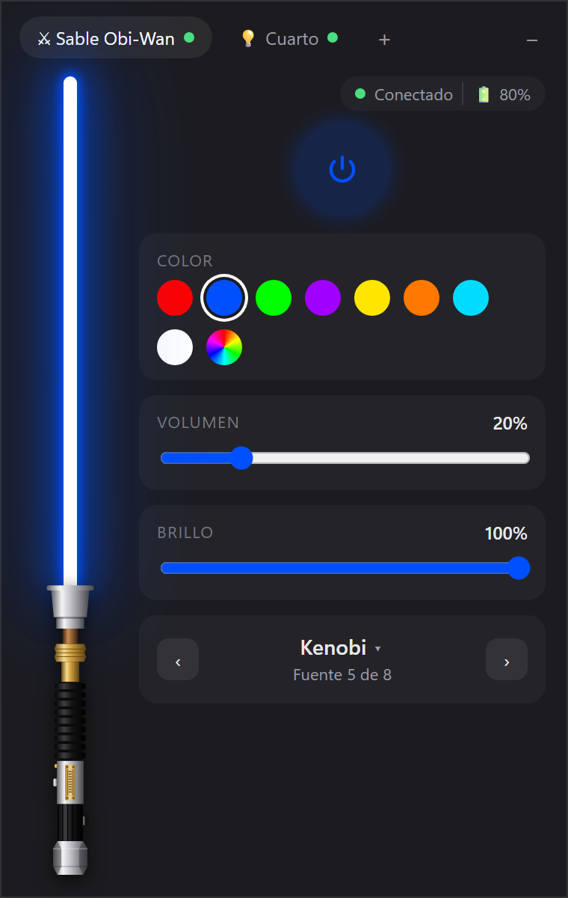
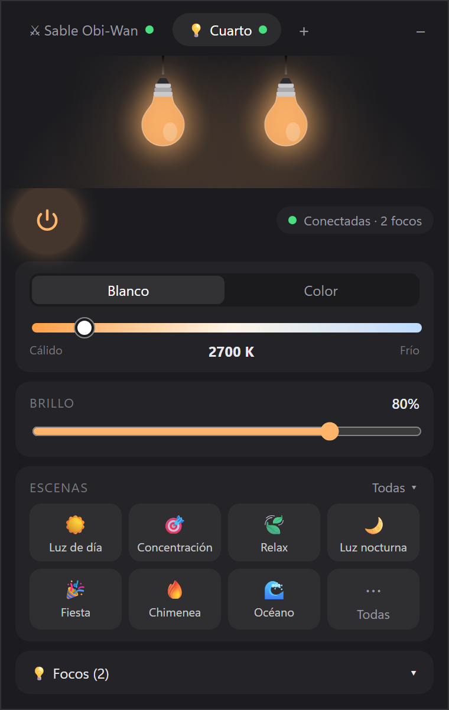
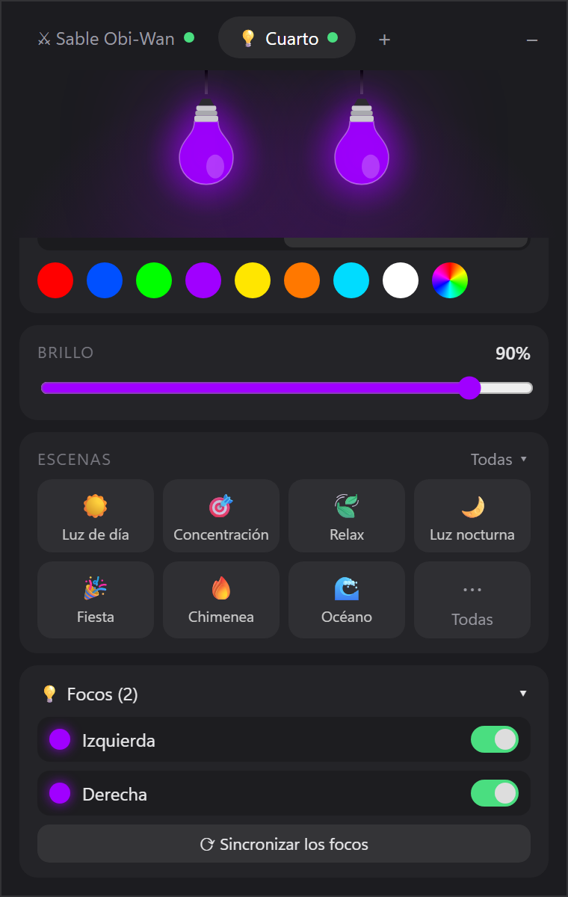
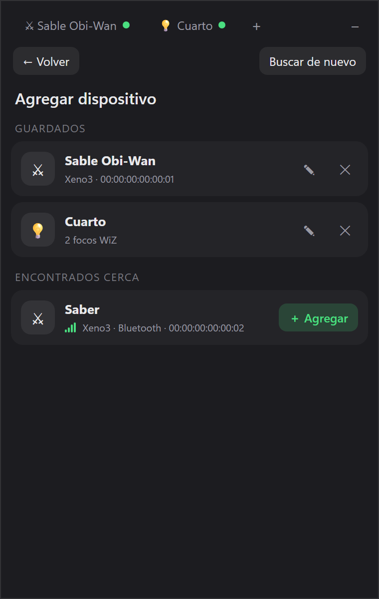

# Desk Control

Widget de escritorio para Windows que reúne en una sola ventanita los dispositivos de mi escritorio:

- ⚔️ **Sables de luz con placa Xeno3**, por Bluetooth: alternativa a la app oficial Xeno Configurator.
- 💡 **Focos inteligentes WiZ**, por wifi: los dos focos del cuarto se controlan juntos, como un solo grupo.

Se abre y se oculta con **Ctrl + Shift + Espacio** y vive en la bandeja del sistema.

<p align="center">
  
  
  
  
</p>

> **Proyecto personal y no oficial.** No está afiliado a Damien Technology (placas Xeno3), a WiZ / Signify,
> a los fabricantes de sables ni a Lucasfilm/Disney. Úsalo bajo tu responsabilidad.

## Qué hace

**Sable (Xeno3)**
- Encender y apagar la hoja, con un sable dibujado que se ilumina del color real.
- Colores rápidos y rueda de color, volumen y brillo con su porcentaje.
- Cambiar la fuente de sonido (anterior, siguiente o elegirla de la lista).
- Estado de conexión y batería. Se conecta solo cuando hace falta y suelta el Bluetooth después de un rato sin uso.

**Focos WiZ (pestaña "Cuarto")**
- Los focos del mismo cuarto se manejan como un grupo sincronizado: encender, blanco cálido↔frío, color, brillo.
- Escenas oficiales de WiZ, con 7 favoritas a mano y la lista completa con ★ para elegirlas.
- Control foco por foco (encender, apagar, renombrar) y un botón para volver a sincronizarlos.
- Si cambiás algo desde la app WiZ del celular, el widget lo muestra en unos segundos. La app del celular
  sigue funcionando igual: el widget no la reemplaza ni la bloquea.
- Si el router le cambia la IP a un foco, lo vuelve a encontrar por su MAC.

## Instalación

Requiere **Windows 11** (probado ahí; en Windows 10 con WebView2 debería andar), **Python 3.12** y, para el sable, Bluetooth.

```bash
git clone https://github.com/MatiasMarrassini/desk-control.git
cd desk-control
python -m venv .venv
.venv/Scripts/python -m pip install -r requirements.txt
.venv/Scripts/pythonw desk_control.pyw
```

La primera vez tocá **＋ → Buscar dispositivos**:
- **Sable:** encendido, cerca y **sin el teléfono conectado** (la placa acepta una sola conexión a la vez).
- **Focos WiZ:** en la misma red wifi que la PC y con **"Permitir comunicación local"** activado en la app WiZ.
  La primera búsqueda puede hacer que el Firewall de Windows pida permiso: permitilo solo en redes privadas.

Desde el icono de la bandeja se puede activar el arranque con Windows y salir del todo (cerrar la ventana solo la oculta).
El atajo se cambia en `%APPDATA%\DeskControl\config.json` y los errores quedan en `%APPDATA%\DeskControl\widget.log`.

## Seguridad y consumo

- **No abre ningún puerto.** La interfaz se carga como archivo local (sin servidor web) y los focos se consultan con
  conexiones salientes de corta vida.
- **Solo comandos permitidos.** Tanto para el sable como para los focos hay una lista cerrada de órdenes: nada de
  reinicios, firmware ni cambios de wifi.
- **Solo consulta a los focos mientras la pestaña está a la vista**. Oculto en la bandeja, el consumo de CPU es prácticamente 0 %.
- El texto que viene de los dispositivos se muestra siempre como texto, nunca como HTML.

## Cómo funciona

- **Python + [pywebview](https://pywebview.flowrl.com/)** (WebView2) para la ventana; la interfaz es HTML, CSS y JavaScript sin frameworks.
- **[bleak](https://github.com/hbldh/bleak)** para Bluetooth LE. El protocolo de las placas Xeno3 está documentado en
  [PROTOCOLO.md](PROTOCOLO.md), obtenido analizando la app oficial de Android y verificado con un sable real.
- **WiZ** usa su protocolo local: JSON por UDP al puerto 38899 (`getPilot`, `setPilot`, `getSystemConfig`).
- [pystray](https://github.com/moses-palmer/pystray) para el icono de la bandeja.

```
widget/
  dispositivos/   protocolo y sesión del sable (BLE), protocolo, transporte y grupo de focos WiZ (UDP)
  escritorio/     bandeja, atajo global, autoarranque y ventana
  ui/             interfaz (una pestaña por dispositivo)
  puente.py       API que usa la interfaz
pruebas/          scripts sueltos para probar el sable y los focos desde la consola
tests/            pruebas automáticas, con un sable y focos simulados
docs/superpowers/ diseño y planes de cada etapa
```

## Scripts de prueba

Sirven para explorar el protocolo sin el widget:

```bash
python pruebas/escanear.py                    # busca placas Xeno3 cercanas
python pruebas/enviar.py                      # conecta y muestra el estado del sable
python pruebas/enviar.py Volume 20            # envía un comando
python pruebas/wiz_descubrir.py               # busca focos WiZ en la red
python pruebas/wiz_escenas.py 192.168.1.6     # verifica las escenas con un foco real
```

Si tenés más de un sable, fijá cuál usar con la variable de entorno `XENO_SABLE` y la dirección que muestra `escanear.py`.

> ⚠️ No envíes `Reset`, `HardwareType`, `SoftwareType`, `ButtonNum` ni comandos de firmware sin entender
> bien qué hacen. Ver la sección de comandos peligrosos en [PROTOCOLO.md](PROTOCOLO.md).

## Pruebas

```bash
.venv/Scripts/python -m pip install -r requirements-dev.txt
.venv/Scripts/python -m pytest
```
